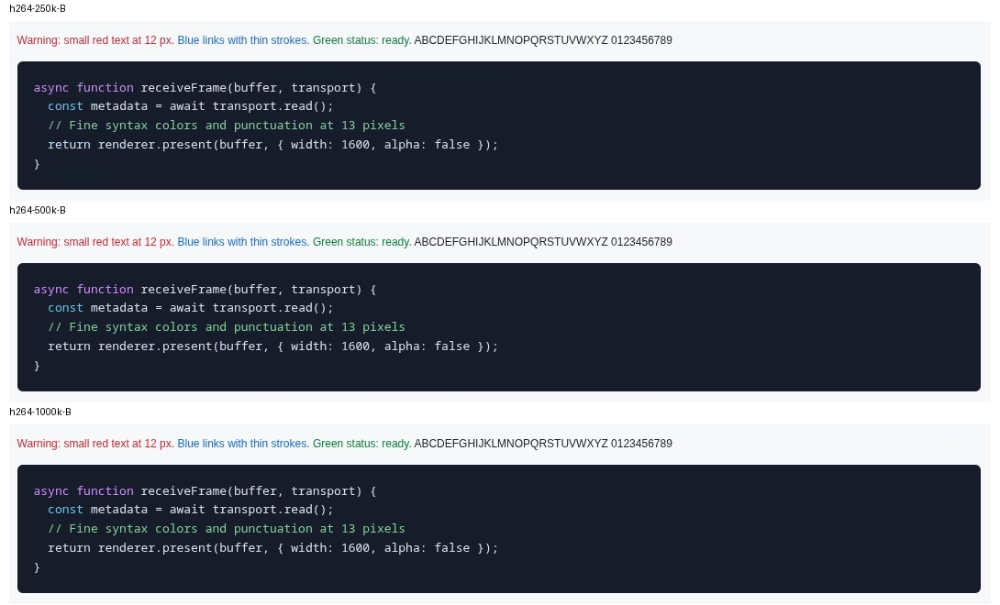

# H.264 bitrate decision, October 30, 2026

## Decision

Use **`bpf=500000`** for new video sessions, replacing `bpf=250000` in launcher
1.5.2. Apply the launcher through chezmoi on Snap, Starship, and Carbon.
Keep hardware selection and the stock lossless recovery path unchanged.
Existing sessions retain their recorded bitrate, including across reset;
stop and launch a fresh session to adopt the new default.

The trigger was visible fuzziness/artifacts during ordinary remote browsing
after the initial hardware-video rollout. In this sweep, 500k approximately
halved document text-edge error relative to 250k, while retaining a large traffic
reduction from lossless. Moving to 1M roughly doubled traffic again for a much
smaller quality gain. This is a quality/bandwidth choice; the experiment does
not establish that 500k improves interactive smoothness.

`bpf` means **bits per frame**, not bits per second. It is an encoder target,
not a network traffic cap: frame rate, codec behavior, non-video surfaces,
compression and SSH overhead affect the observed rate.

## Results

Arithmetic means of two successful repeats per setting, at 1600 × 1342 content
pixels and DPR 1. Traffic is received Mbit/s on the isolated test SSH socket.
PSNR is in dB (higher is better); edge error is mean absolute RGB error on a
0–255 scale (lower is better).

| Setting | Document traffic | Image traffic | Document PSNR | Image PSNR | Document text-edge error | Image text-edge error |
| --- | ---: | ---: | ---: | ---: | ---: | ---: |
| Stock lossless | 45.30 | 119.85 | Pixel-exact | Pixel-exact | 0.00 | 0.00 |
| H.264 100k | 1.55 | 1.56 | 34.53 | 27.20 | 9.68 | 23.85 |
| H.264 250k (previous default) | 3.14 | 3.72 | 37.06 | 32.65 | 7.24 | 6.49 |
| **H.264 500k (selected)** | **6.26** | **8.15** | **41.12** | **34.18** | **3.80** | **4.48** |
| H.264 1M | 12.37 | 16.08 | 41.45 | 34.73 | 3.56 | 3.98 |

500k reduced received traffic by about **86% for documents and 93% for images**
relative to this lossless baseline. Against 500k, 1M added only 0.33 dB document
PSNR and 0.54 dB image PSNR at roughly twice the traffic. All four lossless
captures were pixel-exact. All 3,375 observed video buffers used hardware
decoding; none fell back to software. No Chrome GPU crashes were recorded in
the ten successful cases.

Browser-host Waypipe CPU averaged about 22–24% of one core for lossless versus
1.9% at 500k. Viewer Waypipe averaged 4.9–6.2% versus 0.64–0.69%. These are
process CPU deltas, not total system or GPU utilization.

The immutable [interactive report and full image comparisons](http://snap:8787/reports/226a55f1578dc26eede15d0ddf083ea9af0f87efb65c1268d9ae704310fffb26/)
retain both repeats and scenes. That historical report correctly describes
250k as the default at measurement time; the decision above was made afterward.
Its hostname requires access to Snap. The committed data and workload below
remain available independently of the report server.

## Environment and method

- Browser host: **Snap**, NVIDIA RTX A2000 8GB Laptop GPU, Chrome using NVIDIA
  OpenGL through ANGLE. Native Wayland; Chrome's Vulkan feature disabled.
- Viewer: **Starship**, NVIDIA RTX 5070 Ti, Niri, NVIDIA Vulkan video decoding.
  Direct Tailscale connection; no traffic shaping or injected packet loss.
- Launcher at measurement time: **1.5.1**, commit
  `9b4c7351d5e7210443dd5534c5214a5e9faaf42a`, SHA-256
  `641a99f25ab3a5db9b531e26ece9a308a588bbc0f2f7916bcb8dba573001190e`.
- Installed video package: **waypipe-remote-chrome 0.11.3-3**; stock Waypipe
  **0.11.3-1** coinstalled. Chezmoi recipe stamp:
  `7b3d8e2a624edcb5c469014798b14c4f29c13f5328a42520679a0bdb698f3487`.
  The opaque-alpha patch and lossy 4:2:0 conversion were active for video.
- NVIDIA driver reported by Chrome: **610.57.04**. A fresh temporary Chrome
  profile was used for every case. Existing production Chrome stayed open;
  socket and process-tree measurements isolated the test sessions.

Each case displayed the same offline [workload](workload.html): a document with
12px colored text, 13px code, tables and fine borders, followed by a separate
36-image gallery with generated textures, charts and labels. Only the selected
scene was visible; the harness checked scene identity and rendered-image count.
The content viewport was 1600 × 1342 inside a 1600 × 1432 Chrome window.

After a two-second warmup per scene, `runSweep(12000)` scrolled for 12 seconds
at 650 CSS pixels/second, bouncing through a maximum 4800px span. Every mode
used `zstd=1`. Video cases used `h264,hw,bpf=N` with the installed policy
wrapper on both endpoints, debug/validation disabled, and equal video tracing.
The stock lossless recovery case used `waypipe --no-gpu` and Chrome
`--disable-gpu`; it is therefore not a pure codec-only comparison.

Repeat A ran lossless, 250k, 100k, 1M, 500k. Repeat B reversed that order.
The first 1M B capture timed out; a fresh-profile retry ran at the end and is
the included B result. Optional GPU-enabled lossless diagnostics failed twice
(window discovery and page-evaluation timeout) and are excluded from the table.
An earlier workload revision accidentally showed the document in both phases;
none of those earlier results are included here.

The viewer sampled the exact SSH socket's cumulative TCP byte counters before
and after each phase. Receive Mbit/s is `delta_bytes_received * 8 / elapsed /
1e6`, including SSH/application traffic on that socket and excluding unrelated
browser downloads and production traffic. Process CPU uses matching PID and
start-time identities across snapshots. Frame timing comes from the workload's
`requestAnimationFrame` callbacks; trace markers count decoded video buffers.

After scrolling stopped and approximately 800ms elapsed, the harness captured
Chrome's source pixels through CDP and the receiver's Niri window image. The
receiver's 90px toolbar was cropped before comparison. PSNR and mean absolute
error use RGB content pixels. Text-edge error selects edges in DOM-labeled
text/code/table regions. Final-frame scores do not measure quality throughout
motion. `null` PSNR in the lossless data means infinite PSNR (zero error).

## Evidence and interpretation limits

[results.json](results.json) retains the original unrounded per-case/per-scene
metrics, group means/ranges, renderer and limitations. [audit.json](audit.json)
records completed repeats, exact lossless captures and cleanup checks.
The `root` field in the original results identifies the scratch experiment;
it is provenance, not a required path for reading these committed results.
The workload is self-contained and needs no external images or downloads.

In the JSON, `rx_mbps`/`tx_mbps` are Mbit/s, `fps` is browser callbacks/second,
`decoded_buffer_fps` is decoded buffers/second, and `kb_per_browser_frame` is
**kilobits** received per browser callback. CPU fields are percentages of one
core; `rtt_max_ms` is the maximum sampled TCP RTT, while group `retrans_total`
is a sum across repeats. Group quality/rate/timing fields are arithmetic means.
The report bundle contains full source/receiver images and per-repeat views;
the repository retains a smaller representative crop sheet.

Viewer focus changed during the sweep, RTT varied, and requestAnimationFrame
is not physical presentation FPS or input latency. Two short repeats do not
establish statistical significance. The comparison supports the measured
quality/traffic tradeoff, not a definitive smoothness ranking or a claim that
network transport caused every earlier stall. Carbon's Intel decoding was
qualified separately at 250k; Carbon was not part of this bitrate sweep.

If artifacts remain troublesome, compare 500k with 1M on the affected real page
and display scale. If bandwidth or latency becomes limiting, repeat at 250k
and 500k on that path with controlled focus and matched scene/frame pacing.
For exact pixels, use the existing `--transport lossless` recovery option on
a fresh launch. Changing the policy later should retain the old canonical
bitrate in reset parsing and append a new dated result rather than rewriting
this study.

## Transport follow-up, October 30, 2026

The [follow-up checkpoint](../transport-2026-10-30/checkpoint.json) records
launcher 1.6.0 and the managed `waypipe-remote-chrome 0.11.3-4` deployment to
Snap, Starship, and Carbon. Live status now distinguishes recorded settings
from observed encoder/decoder backends. Launch and reset check the compiled
FFmpeg ABI before changing a browser; the managed installer rebuilds in an
ABI-specific clean directory. Existing production sessions were preserved.

All eight disposable functional cases passed: hardware video at 500k and
250k, software video at 500k, and stock lossless on each viewer. Installed
reset preserved both recorded bitrates and recreated the intended stream.
Fresh ABI queries matched libavcodec 63 and libavutil 61 on all three hosts.
Some initial Starship geometry observations preceded resize settlement, so
these checks establish lifecycle/backend behavior, not matched performance.

The earlier checkpoint had no accepted latency comparison. The completed
Starship matrix below supersedes that pending status; the checkpoint remains
unchanged as a historical record. Starship's explicit `desktop-away away`
latch was keeping its display off. `desktop-away resume` released it, and
direct local GTK callbacks rose from 0.91/s to 113.88/s. Fresh native remote
Chrome calibration passed before the matrix. This resolves the local one-Hz
calibration confound; it does not identify the cause of the earlier browsing
episode. [Resumption context](../transport-2026-10-30/resumption-context.json)
retains the display evidence and excluded harness attempts.

The October 30 Starship matrix contains 36 sixty-second trials: three repeats
of hardware H.264 at 500000 bits/frame and stock lossless, under six conditions.
The fixed viewport was 1200×760 CSS pixels, DPR 1, on DP-1 at
5120×1440/144 Hz. Both modes used `zstd=1`. Lossless used Waypipe `--no-gpu`
and Chrome `--disable-gpu`; video kept Chrome GPU rendering enabled with
Vulkan disabled. This compares the deployed product modes, including their
rendering policies. All video trials confirmed a hardware encoder on Snap and
hardware decoder on Starship. Chrome's own GPU status is recorded separately.

| Condition | Mode | Receive Mbit/s | Callbacks/s | Median input bracket, ms | p95 input bracket, ms | Latency runs | Echoes |
|---|---|---:|---:|---:|---:|---:|---:|
| Native | H.264 HW | 6.8 | 20.6 | 179–258 | 329–405 | 3/3 | 54/54 |
| Native | Lossless | 18.1 | 24.3 | 104–185 | 209–290 | 3/3 | 54/54 |
| Unshaped proxy | H.264 HW | 4.9 | 11.1 | 350–441 | 525–651 | 2/3 | 54/54 |
| Unshaped proxy | Lossless | 6.6 | 9.7 | 338–419 | 462–543 | 3/3 | 54/54 |
| +50 ms RTT | H.264 HW | 3.5 | 8.0 | 538–618 | 798–879 | 3/3 | 54/54 |
| +50 ms RTT | Lossless | 5.6 | 8.1 | 438–518 | 607–688 | 3/3 | 54/54 |
| 25 ± 10 ms each way | H.264 HW | 2.8 | 6.6 | 638–717 | 837–915 | 3/3 | 54/54 |
| 25 ± 10 ms each way | Lossless | 4.1 | 6.0 | 555–634 | 730–810 | 3/3 | 54/54 |
| 0.5% loss each way + delay | H.264 HW | 2.4 | 5.7 | 771–850 | 1429–1509 | 3/3 | 54/54 |
| 0.5% loss each way + delay | Lossless | 3.2 | 4.8 | 771–852 | 1110–1190 | 3/3 | 54/54 |
| 10 Mbit/s each way | H.264 HW | 4.8 | 11.1 | 338–440 | 703–783 | 1/3 | 54/54 |
| 10 Mbit/s each way | Lossless | 4.5 | 6.7 | 1497–1580 | 1642–1726 | 3/3 | 51/51 |

Receive rates are delivered TCP payload on one identified SSH connection,
including protocol and CDP control traffic, excluding IP/TCP headers and
retransmitted copies. Callback rates are browser callbacks, not physical
presentation FPS. Input timing measures virtual F8 injection to a matching
received image, with conservative capture brackets; it is not physical
input-to-photon latency. Table values are means of per-run metrics. Median
and p95 brackets use the qualified latency runs shown, not pooled events.
JSON retains each run and its ranges; these are descriptive observations,
not confidence intervals or a statistically established smoothness ranking.

All 645 attempted inputs were echoed, with zero timeouts or incomplete events.
Only one key was outstanding at a time. Attempts were nominally every three
seconds but waited for an echo or five-second timeout; one slow capped
lossless run therefore attempted 15 keys instead of 18. Input injection
stopped five seconds before the end to permit drain.

Native video averaged 6.83 Mbit/s versus 18.10 for lossless,
a 62.2% reduction for this workload. It also had lower
measured process CPU, while its mean native input timing and callback pacing
did not improve. The earlier large-document/image study's 86–93% savings are
not universal. Compare traffic together with pacing: a slower producer also
sends fewer frames.

| Condition | Mode | Snap Waypipe CPU | Snap Chrome CPU | Starship Waypipe CPU |
|---|---|---:|---:|---:|
| Native | H.264 HW | 2.0% | 11.6% | 0.8% |
| Native | Lossless | 12.9% | 22.4% | 2.7% |
| 10 Mbit/s each way | H.264 HW | 1.6% | 8.6% | 0.6% |
| 10 Mbit/s each way | Lossless | 3.9% | 9.3% | 0.9% |

CPU percentages are of one core and use matching PID/start-time snapshots.
They omit new/exited processes, Niri, capture helpers and whole-host activity,
and can hide short peaks or individual busy threads. GPU utilization was not
measured. The 20 Hz screen captures and 1 Hz telemetry add observer load;
capture costs are retained. These averages do not rule out every CPU/GPU
stall or establish ordinary-browsing timing.

**The unshaped proxy itself substantially changed pacing and latency.** It
splits TCP into real-path and private-path connections with different
buffering and congestion control. Compare impaired trials with that proxy
control; do not interpret them as quantitative predictions for adding the
same impairment to the native path. Native physical-path sender counters also
recorded retransmissions: 80 over the video repeats and 48 over lossless.
The physical path and shared production load were not held constant.

The isolated setup used three temporary network namespaces and a private Unix
bridge. Host routing, forwarding, firewall and queue settings were preserved.
Fixed delay was 25 ms each way; jitter used 25 ± 10 ms normally distributed
each way; loss used seeded 0.5% loss each way plus fixed delay; the cap was
10 Mbit/s each way. The
[network-only calibration](../transport-2026-10-30/network-profile-calibration.json)
verified approximately 50 ms added RTT and 9.55 Mbit/s capped payload throughput.
Queue/drop figures use first/last sample deltas because counters persist across
qdisc replacements. Queue peaks are 1 Hz samples and may miss short bursts.
Sender retransmissions on the real and synthetic legs are recorded separately;
their RTT estimates cover different TCP legs. The Carbon-to-Snap production
session stayed running and could contend for shared network/GPU resources.

Input markers have complements and CRC checks; frame counters have their own
complement. The predeclared latency-quality gate requires fewer than 5%
undecodable input captures. Native calibration must pass it. Full trials
failing it retain network/CPU and per-event evidence, but are excluded from
group latency summaries. **33/36 trials qualified.** Excluded latency trials:
`study-v5-starship-cap-h264-r2`,
`study-v5-starship-cap-h264-r3`, and
`study-v5-starship-proxy-h264-r1`.
The capped-video cell has only one qualifying latency run, so it does
not support a repeatable timing ranking. Invalid frame counters are separate
diagnostics; missing observations can inflate receiver frame gaps. These
inconsistencies have not been localized to Chrome rendering, Waypipe, encoder,
decoder, or compositor. They are not a full-page image-quality score.

The [results](../transport-2026-10-30/results.json),
[independent consistency audit](../transport-2026-10-30/audit.json),
[environment](../transport-2026-10-30/environment.json),
[workload](../transport-2026-10-30/workload.html), and
[study harness manifest](../transport-2026-10-30/harness/manifest.json)
preserve the comparison. The manifest records one whitespace-only publication
adjustment; exact measured code remains in the frozen archive.
Reproduction requires an available desktop and the
recorded host setup: copy the harness to its recorded base on both hosts.
It focuses a window, injects keys, and creates private network namespaces with
sudo; it is a one-off experiment. Raw records, excluded attempts and frozen
revisions are retained in the private local study cache, with their hashes in
[artifact-manifest.json](../transport-2026-10-30/artifact-manifest.json).

[Cleanup](../transport-2026-10-30/cleanup.json) verified the temporary network
setup was removed, all original production process identities were unchanged,
and 74 disposable profiles were removed. Starship's original window focus and
explicit away state were restored. Launcher bytes/modes, package recipe and
FFmpeg ABI remained correct on Snap, Starship and Carbon; unrelated chezmoi
files were preserved.

Defaults remain hardware-preferred H.264 at 500000 bits/frame with `zstd=1`.
Carbon's controlled performance comparison stays pending while its desktop is
in use; its earlier functional hardware/software/lossless/reset checks passed.
Ordinary-page smoothness and artifact acceptance remain a user check. The
existing `--transport lossless` option remains available for exact pixels.
